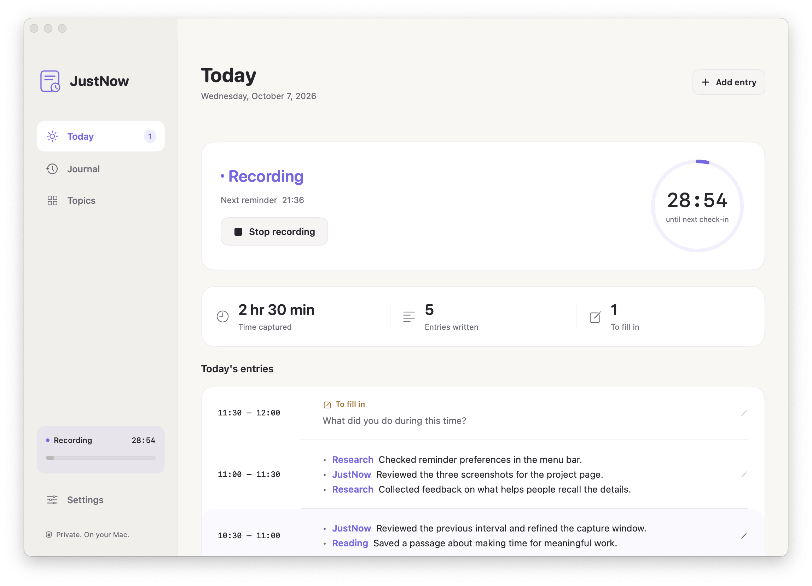
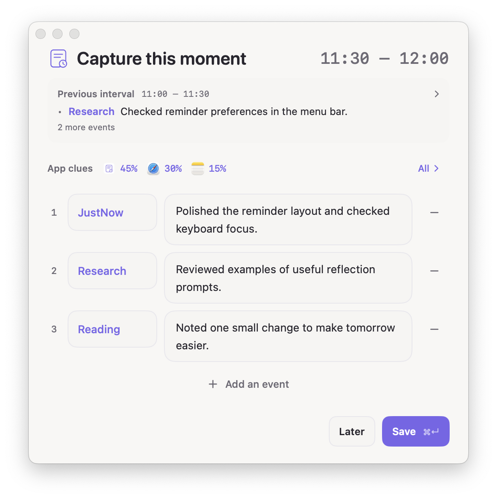
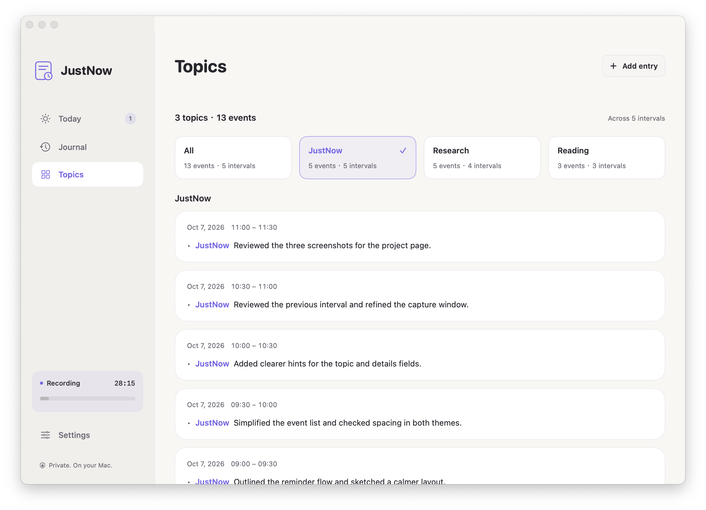

# JustNow

English | [简体中文](README.zh-CN.md)

**A native macOS journal for recording what you did.**

JustNow prompts you to recall the previous interval and write down its events. Each event has a topic and details; topics are entered as you write, with no projects or tasks to create beforehand. Built with SwiftUI and AppKit.

[Download for macOS](https://github.com/AbyssSkb/JustNow/releases/latest) · [Report an issue](https://github.com/AbyssSkb/JustNow/issues) · [Release guide](docs/RELEASING.md)



## Record an interval

Recording starts on launch by default, after first-run setup. Every 30 minutes, a compact reminder shows the interval that just ended. Add a topic and details for each event, leave the topic blank for **Other**, and press `Enter` to add another item. `Command-Return` saves the entry. The window grows with the list, then scrolls when it reaches its height limit.

The previous interval is available as a read-only reference. Optional app clues show the foreground applications you used and their share of the interval. They help you recall the details; you write the entry yourself.



Choose **Later** to leave an interval pending, or skip a blank interval. Drafts save automatically. You can fill in pending entries, add a missing interval, or edit existing entries from the journal.

Intervals run from the time you start: a 09:07 start with a 30-minute interval produces 09:07–09:37, then 09:37–10:07. Saving an entry keeps the reminder schedule unchanged. Settings accepts intervals from 1 to 240 minutes; a change applies to the next recording session.

## Review by day and topic

Today shows entries in reverse chronological order. Browse other dates in the journal, search within a day, and adjust an entry's dates, times and events.

Topics groups saved events and counts both events and distinct intervals. A single interval can contain several topics. Case variants of the same topic are combined. These counts do not estimate time spent on a topic.



Older plain-text entries keep their original text. They enter topic statistics after you edit and save them with event fields. Pending entries are excluded from these statistics.

*Screenshots show the native application using example data.*

## Start, stop and return

Start or stop recording from the main window or menu bar. Stopping captures the final partial interval; you can skip it if there is nothing to record. You can turn off recording on launch in Settings.

Sleep, display sleep and switching away from your macOS user session pause recording. By default, 30 minutes without keyboard or mouse activity also pauses it; this inactivity rule can be disabled. On return, choose whether to skip the gap and continue from now, or keep it as intervals to fill in. Paused sessions stay paused across restarts and updates until you decide.

Settings also includes English and Chinese, light and dark appearance, reminder sound, app clues and launch at login.

## Your data

Records and drafts are stored as local JSON in:

```text
~/Library/Application Support/JustNow/
```

JustNow keeps a backup of the previous successful save and exports CSV or JSON. JSON includes events, topics and app clues; CSV contains the entry's text, times and status. Use exports or your own backup system for longer-term backups.

App clues are optional and collected only while recording. They store application names, bundle identifiers and foreground duration with each interval. Percentages use the whole interval; unobserved time is shown separately. Clues stay available when editing later, and retain their original measurement range if you change an entry's times.

There is no account, telemetry or cloud sync. JustNow does not collect screenshots, window titles, URLs, browsing history, file contents or keystroke contents. Inactivity detection reads the system's aggregate idle duration. Network access is used for update checks and downloads; journal data stays on your Mac.

## Install and update

Requires **macOS 14 or later**. Universal release downloads support **Apple silicon and Intel Macs**.

1. Download the latest DMG from [Releases](https://github.com/AbyssSkb/JustNow/releases/latest).
2. Open it and drag JustNow into Applications. The ZIP contains the same app.
3. Open JustNow and complete first-run setup. Recording then starts with the default 30-minute interval.

Release builds use Sparkle and the [GitHub update feed](https://github.com/AbyssSkb/JustNow/releases/latest/download/appcast.xml). Check for updates from the app menu or Settings. Before an in-app update restarts the application, JustNow saves the current session and drafts; the new version continues the reminder schedule and preserves any paused state. Source builds use the same feed by default; explicitly unconfigured builds disable update checks.

**Signing:** Check the release notes for the package's signing status. Builds without an Apple Developer signing identity use ad-hoc signing and are not notarized; macOS may block downloaded copies. Release signing and notarization instructions are in the [release guide](docs/RELEASING.md).

## Build from source

Requires macOS 14 or later, a **Swift 6.2 toolchain**, Xcode Command Line Tools and Python 3 for the native editor check. Swift Package Manager downloads the Sparkle framework.

```sh
git clone https://github.com/AbyssSkb/JustNow.git
cd JustNow
swift test --no-parallel
python3 scripts/check-editor-wrapping.py
./scripts/build-app.sh
open dist/JustNow.app
```

The build script creates a universal app, ZIP, DMG and SHA-256 checksums in `dist/`. See [CONTRIBUTING.md](CONTRIBUTING.md) for development checks and [docs/RELEASING.md](docs/RELEASING.md) for signed updates and release packaging.

## Feedback and license

Report bugs and suggestions through [GitHub Issues](https://github.com/AbyssSkb/JustNow/issues). Include your macOS and JustNow versions, steps to reproduce, and screenshots with private content removed.

JustNow is available under the [MIT license](LICENSE).
