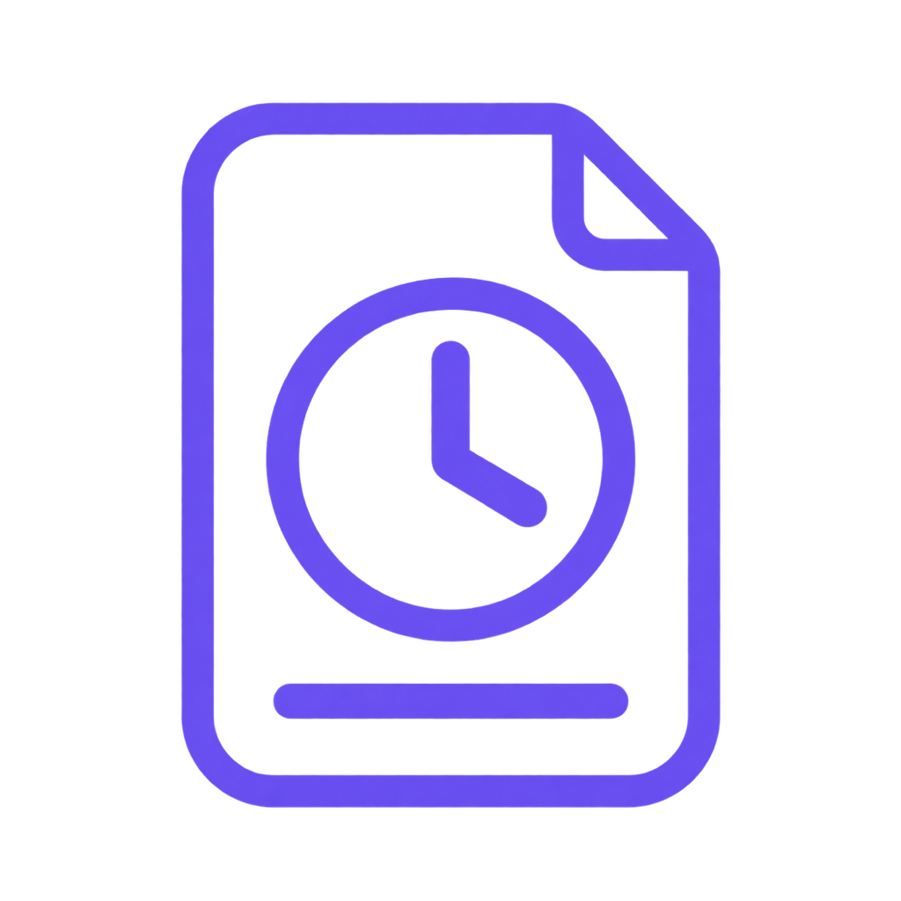
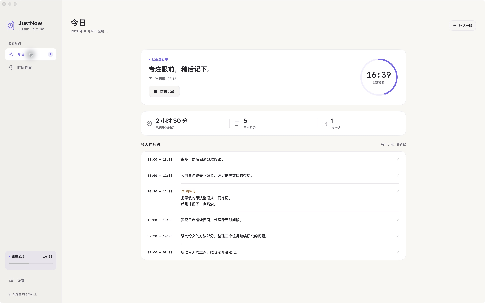
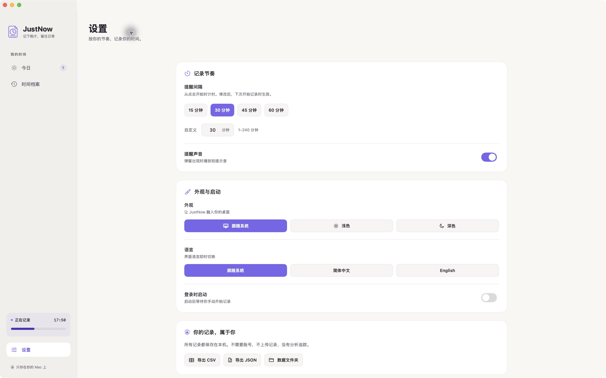
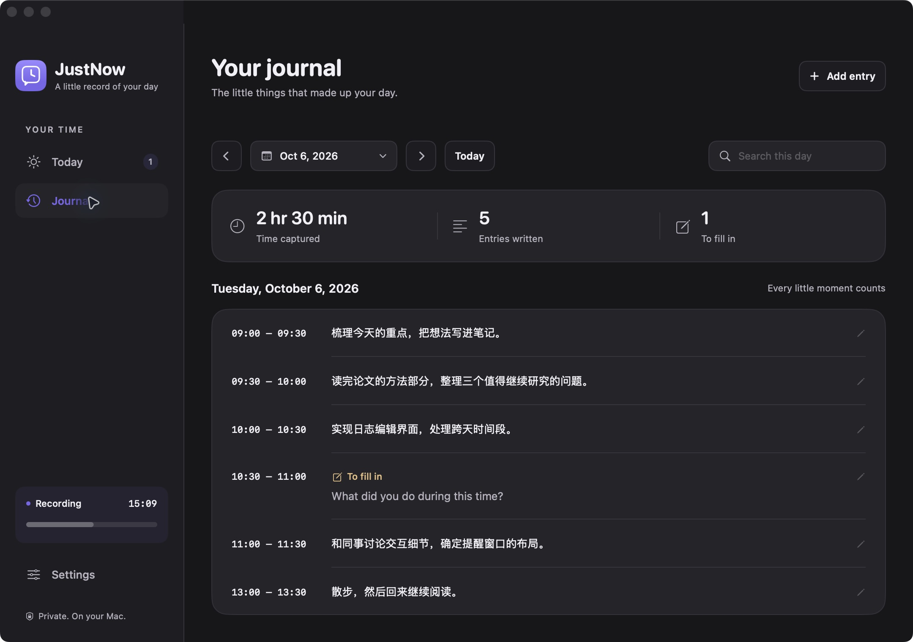

<p align="center">
  
</p>

# JustNow · 刚才

**刚才这半小时，你做了什么？**

JustNow 是一个原生 macOS 时间日志。手动开始后，每隔一段时间弹出一个小窗口，写一句话，继续手头的事。没有需要提前维护的 Project / Task，也没有后台活动监控。

免费开源 · 本地存储 · 无账号 · macOS 14+ · Apple Silicon 与 Intel



<details>
<summary>查看提醒与编辑窗口、设置、深色外观与首次使用引导</summary>







</details>

## 为什么做这个

我们想保留定时回顾的习惯，同时让记录足够轻：不用事先定义任务，不用全天开着计时器，也不用把私人活动上传到服务端。JustNow 只在你主动开始后工作。

## 核心体验

- **手动开始，手动停止。** 默认 30 分钟一次；可在设置中更改间隔。
- **直接写刚才做了什么。** 每段记录包含起止时间与自由文字，长文本自动换行，支持多行。
- **时间线与回顾。** 今日最新片段在最上面，保存后立即显示，跨午夜自动更新日期；可以按日期查看、搜索、修改历史记录，也可以手动补记。
- **漏填也能补。** 点「稍后」保留待填写时间段，不丢失它的位置。
- **本地保存与导出。** JSON 日志自动保存，保留上一次成功保存的备份，支持 CSV / JSON 导出。
- **随时从菜单栏操作。** 查看状态、打开日志、开始或结束记录。
- **清楚的选择控件。** 日期与时间使用专用弹层，小时和分钟分开选择；外观和中英文语言选项在设置中并排展示。
- **记录中也能更新。** 配置更新源的版本可在应用内检查、下载并安装 GitHub 上的新版本，更新重启后接续当前记录和提醒节奏。

## 安装

正式版本发布后，可在 [Releases](https://github.com/AbyssSkb/justnow/releases) 选择通用版 DMG，打开后将 JustNow 拖入 Applications。ZIP 包也包含同一个应用。最低系统版本是 **macOS 14 Sonoma**。

**签名状态：** 本仓库默认构建和 CI 附件使用 ad-hoc 签名，尚未经过 Apple 公证。从网络下载后 Gatekeeper 可能阻止打开；这与本机编译运行不同。正常的公开分发需要发布者使用 Developer ID Application 证书签名并经过 Apple 公证，请以对应 Release 的签名说明为准。当前没有可承诺无警告安装的已公证版本。

你也可以直接从源码构建：

```sh
git clone https://github.com/AbyssSkb/justnow.git
cd justnow
swift test
python3 scripts/check-editor-wrapping.py
./scripts/build-app.sh
open dist/JustNow.app
```

需要 Xcode Command Line Tools（Swift 5.9+）；`xcode-select --install` 可安装。Swift Package Manager 会下载用于安全更新的 [Sparkle](https://sparkle-project.org/) 二进制框架。构建脚本会生成 `dist/JustNow.app`、通用 ZIP、DMG 与 SHA-256 校验文件。

## 应用内更新

从 0.1.8 起，发布者配置了更新源与签名公钥的版本可以在菜单或设置中「检查更新」。应用会定期检查 GitHub 更新源，发现新版后由你决定是否下载和安装。未配置更新源的本地构建会显示尚未配置；不会连接示例地址。

安装前，应用先保存当前会话和正在填写的提醒、编辑草稿。新版重启后恢复当前会话、草稿与原来的下一次提醒时间，更新用时仍归入正在记录的时间段，不会产生一段额外记录。普通退出或重启电脑仍需手动开始。更新接续只允许在保存交接状态后的 5 分钟内生效，过期后按普通启动处理。

## 怎么记录

1. 打开 JustNow，点击「开始记录」。
2. 到时间后，弹窗显示刚结束的时间段。输入文字，点击保存。
3. 忙的时候可以点「稍后」，之后从时间线补写。
4. 工作告一段落，点击「停止记录」；不足一个间隔的最后一段也可以填写。

计时从点击开始的时刻计算，而不是对齐钟表刻度。例如 09:07 开始、间隔 30 分钟，第一段是 09:07–09:37，第二段是 09:37–10:07。**填写和保存不会推迟下一次提醒**。更改间隔对下一次开始记录生效。

Mac 进入睡眠时暂停，唤醒后仅恢复此前正在进行的记录；睡眠时间不会算作活动时间。普通退出或重启后不会自动开始计时；异常退出留下的记录可按上次保存的活动状态恢复为待填写时段，再由你手动开始新一轮。通过应用内更新重启时会自动接续此前的会话。

## 你的数据

日志保存在：

```text
~/Library/Application Support/JustNow/
```

数据采用本地 JSON 文件，保留上一次成功保存的备份。可通过应用导出 CSV 或 JSON，方便迁移、长期备份和自己的分析。上一次保存备份不能替代跨设备备份；请按需要将导出文件保存在自己的备份位置。

JustNow **不读取屏幕、应用使用记录或浏览器历史，不包含遥测，不需要账号**。时间日志离线保存；网络仅用于已配置的版本检查更新和下载安装包，不上传你的记录。应用不提供云同步；你拥有原始数据。

## 发布签名与公证

本地使用可以直接构建。准备公开发布时，需要提供 `notarytool` / `stapler` 的 Xcode 工具、Apple Developer Program 的 Developer ID Application 证书，以及保存在 macOS Keychain 中的 `notarytool` 凭据配置；**不要把证书、密码或私钥提交到 GitHub**。

```sh
SIGNING_IDENTITY='Developer ID Application: Your Name (TEAMID)' \
VERSION=0.1.8 ./scripts/build-app.sh

SIGNING_IDENTITY='Developer ID Application: Your Name (TEAMID)' \
NOTARY_PROFILE='justnow-notary' ./scripts/notarize.sh
```

先按照 [Apple 的公证流程](https://developer.apple.com/documentation/security/customizing-the-notarization-workflow) 创建 Keychain profile。脚本会检查 Developer ID 签名、hardened runtime 与时间戳；提交 ZIP、等待通过后将票据附加到 app，再重新生成 ZIP / DMG，提交并附加 DMG 票据，最后验证与更新校验文件。ZIP 本身不能附加票据，分发的 ZIP 内包含已附加票据的 app。

GitHub Actions 在 push / PR 时测试与构建；推送 `v0.1.8` 这类标签会创建一个带安装包的**草稿 Release**。CI 未配置签名凭据，附件会明确标为 ad-hoc / 未公证。正式发布前，用公证后的安装包替换草稿附件。没有证书时，仍可分享源码和清楚标注签名状态的构建。

若要让 CI 构建包含更新配置，在 GitHub Actions 的仓库变量中同时设置 `UPDATE_FEED_URL` 和 `UPDATE_PUBLIC_ED_KEY`。签名私钥仍由发布者保管，当前工作流不会生成或发布更新源。

### 发布 GitHub 更新源

更新安装使用 Sparkle 的 Ed25519 签名验证下载包。发布者需先确定 GitHub 仓库，并用 Sparkle 自带的 `generate_keys` 生成一次签名密钥。私钥默认保存在登录 Keychain，只把输出的公钥用于构建；不要把私钥、Keychain 或导出的密钥文件提交到仓库。工具随 SwiftPM 二进制依赖下载，在构建后位于 `.build-release/arm64/artifacts/sparkle/Sparkle/bin/`。详见 [Sparkle 官方设置说明](https://sparkle-project.org/documentation/)。

```sh
.build-release/arm64/artifacts/sparkle/Sparkle/bin/generate_keys

UPDATE_FEED_URL='https://github.com/OWNER/justnow/releases/latest/download/appcast.xml' \
UPDATE_PUBLIC_ED_KEY='GENERATE_KEYS_PRINTED_PUBLIC_KEY' \
SIGNING_IDENTITY='Developer ID Application: Your Name (TEAMID)' \
VERSION=0.1.8 ./scripts/build-app.sh

SIGNING_IDENTITY='Developer ID Application: Your Name (TEAMID)' \
NOTARY_PROFILE='justnow-notary' ./scripts/notarize.sh

DOWNLOAD_URL_PREFIX='https://github.com/OWNER/justnow/releases/download/v0.1.8/' \
./scripts/generate-update-feed.sh
```

将 `OWNER` 替换为实际发布账号；更新源和公钥必须同时提供。每次发布先构建、公证，最后运行生成更新源的脚本，由官方 `generate_appcast` 从 Keychain 读取私钥并签名。它会生成 `dist/update-feed/appcast.xml`，保留已有更新条目，并关闭差分包生成。若密钥保存在受保护的文件中，可用 `SPARKLE_ED_KEY_FILE` 指定文件路径；工具在其他位置时可用 `SPARKLE_BIN_DIR` 指定其 `bin` 目录。

把 `appcast.xml` 与 `JustNow-0.1.8-universal.zip` 上传到同一个 `v0.1.8` GitHub Release，再发布为最新正式版。下个版本改用新的版本号和对应的下载前缀，保持已发版本的附件地址与字节不变。可在生成前把与 ZIP 同名的 `.html` 或 `.md` 更新说明放入 `dist/update-feed/`。CI 草稿附件没有更新签名，不应直接当作应用内更新源；完成签名、公证后再上传更新源。脚本不创建或发布 GitHub Release。

## 参与开发

详见 [CONTRIBUTING.md](CONTRIBUTING.md)。macOS Dock 和 Finder 图标使用白色圆角底板上的紫色文档与时钟轮廓，源图是 `Resources/AppIcon-macOS-source.png`，编辑提示词是 `Resources/AppIcon-macOS-prompt.txt`。

应用内使用透明紫色轮廓标识，源图仍是 `Resources/AppIcon-source.png`，提示词是 `Resources/AppIcon-outline-prompt.txt`；`Resources/AppIcon-prompt.txt` 保留为设计历史。

`scripts/generate-icon.swift` 使用原生 AppKit 从这两张 PNG 缩放生成 macOS ICNS、预览图和透明品牌资源。运行以下命令可重现图标资源，无需下载素材或安装第三方包：

```sh
swift scripts/generate-icon.swift Resources
```

许可采用 [MIT](LICENSE)。

---

## English

**What did you do just now?**

JustNow is a native, local-first activity journal for macOS 14+. Start a session manually, receive a prompt every 30 minutes by default, and describe the previous interval in your own words. No projects or tasks to set up. Apple Silicon and Intel are supported by the same universal build.

- Adjustable intervals; saving an entry does not reset the timer.
- Custom date and time popovers with separate hour and minute selection; appearance and language options displayed directly in Settings.
- Free text wraps automatically. Today shows new entries immediately, newest first, and follows the current date across midnight. Browse daily history, search, edit, backfill, and return to pending entries when you choose Later.
- Stop captures the final partial interval. Sleep pauses tracking; waking resumes only an active session. Ordinary relaunch requires a manual start; an in-app update restores the session, draft and original reminder schedule within a five-minute handoff window.
- Local JSON journal with previous-save backup, plus CSV / JSON export.
- No account, telemetry, screen monitoring, or browsing history access. Network access is limited to configured update checks and downloads; journal data stays local.
- Built-in GitHub updates use Sparkle archive signatures, with installation confirmed by the user. Update checks remain unavailable in builds without a feed URL and public key.

Validate with `swift test` and `python3 scripts/check-editor-wrapping.py`, then build with `./scripts/build-app.sh` and open `dist/JustNow.app`. Requires Xcode Command Line Tools and Swift 5.9+. Data lives in `~/Library/Application Support/JustNow/`.

**Distribution:** Default builds are ad-hoc signed and **not notarized**; Gatekeeper may block downloaded copies. A verified public release requires a Developer ID Application certificate and Apple notarization. Set `SIGNING_IDENTITY` when building, then run `scripts/notarize.sh` with the same identity and a `NOTARY_PROFILE` stored in Keychain. Tag builds create draft releases, so maintainers can replace CI assets with notarized packages before publishing. For in-app updates, generate an Ed25519 key with Sparkle's `generate_keys`, build with both `UPDATE_FEED_URL` and `UPDATE_PUBLIC_ED_KEY`, then run `scripts/generate-update-feed.sh` after notarization with an HTTPS `DOWNLOAD_URL_PREFIX`. Publish its signed `appcast.xml` alongside the versioned ZIP on GitHub Releases. Keep private keys outside the repository.

Free and open source under the MIT license. Contributions welcome.
